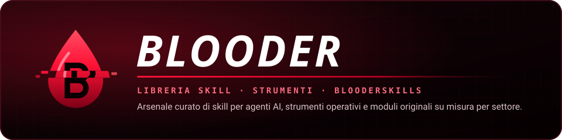

<div align="center">
  

  <br />

  
  
  
  
  
</div>

---

## Cos'è Blooder

**Blooder** è una libreria interattiva locale e open-source dal design **Red Matrix** progettata per raccogliere, filtrare e potenziare il meglio dell'ecosistema per **Agenti AI e sviluppo moderno**, senza dipendere da database cloud esterni o dipendenze pesanti.

L'architettura è divisa in **tre reparti complementari**:

1. **Libreria Skill** — Selezione ragionata delle migliori skill open-source per agenti AI, spiegate senza gergo inutile, con pro, contro onesti e risparmio reale.
2. **Strumenti** — Utility operative e CLI ad alto impatto per automatizzare desktop, API, sicurezza e mobile.
3. **Blooderskills** — Il laboratorio originale di **Blooder**: moduli specialistici verticali (*"il pezzo in più"*) costruiti per settore piattaforma (Fatturazione, Vendita, Guide, Automazione), collaudati sul campo ed esportati automaticamente in [`skills/`](skills/) per l'installazione diretta.

---

## Blooderskills pubblicate (Moduli originali)

Installa qualsiasi modulo originale **Blooderskill** direttamente nel tuo agente AI con:

```bash
npx skills add raffaeleditullo-cloud/Blooder --skill <nome-skill>
```

| Modulo | Settore Piattaforma | Potenzia | Stato | Descrizione |
| :--- | :--- | :--- | :--- | :--- |
| **[`Meta & Design Creative Studio`](skills/meta-creative-studio/SKILL.md)** | `Marketing, Design & Meta Ads` | ui-ux-pro-max, 21st-dev, scroll-cinema-web, anatomy, motionmaxxing, marketing-psychology, cro, sepia | Collaudata | Dal brief zero-file a idee creative, design Claude (post/siti Lovable & WordPress) e setup completo Meta Ads |
| **[`blooder-reel-kit`](skills/blooder-reel-kit/SKILL.md)** | `Video & Media` | motionmaxxing, sound-design, sepia | Collaudata | Kit visivo 9:16 vettoriale Red Matrix con camera 3D continua, sottotitoli WordBoundary e suoni CC0 gratuiti da Openverse API. |
| **[`Service-as-a-Software Italia`](skills/service-as-software-it/SKILL.md)** | `Strategia Business, Prezzi & Servizi AI (Italia)` | Founder, Sepia, Marketing Psychology | Collaudata | Calcola al centesimo (con tasse e INPS reali italiani) quando conviene vendere il Servizio Finito erogato con l'AI invece del classico abbonamento SaaS da 39€/mese. |
| **[`Scroll Cinema Web`](skills/scroll-cinema-web/SKILL.md)** | `Web Design & Landing Page Cinematografiche` | motionmaxxing, Anatomy, Marketing Psychology, Sepia | Collaudata | Trasforma un breve video AI in un sito web interattivo a 60fps controllato dallo scroll del mouse (stile Apple) con taglio automatico WebP Desktop/Mobile. |
| **[`FatturaPA X-Ray`](skills/fatturapa-xray/SKILL.md)** | `Fatturazione & Fisco Italia` | Founder, Anatomy, Teach | Collaudata | Raggi X per Fatture Elettroniche Italiane (.xml e .xml.p7m): scova rincari nascosti dei fornitori, blocca gli scarti SdI e calcola il netto vero tolte IVA e tasse. |

---

## Libreria Skill (17 selezionate)

| Skill | Categoria | Cosa fa in una riga |
| :--- | :--- | :--- |
| **[CLI-Anything](https://github.com/HKUDS/CLI-Anything)** | `Agenti AI & Automazione` | Trasforma qualsiasi software desktop o repository in una CLI con output JSON e SKILL.md pronto per l'agente, senza dover installare un server MCP per ogni app. |
| **[i-have-adhd (Formato QA Diretto)](https://github.com/ayghri/i-have-adhd)** | `Qualità Codice & Regole` | Impone agli agenti di Controllo Qualità e revisione di andare dritti all’errore, alla riga esatta e al comando di verifica, tagliando zero chiacchiere. |
| **[motionmaxxing](https://github.com/Tejashmakwana/motionmaxxing)** | `Video & Media` | Trasforma un sito o un brand in video promozionali animati da vero motion designer in locale (HTML + GSAP + FFmpeg), eliminando le slide piatte da AI. |
| **[Strix](https://github.com/usestrix/strix)** | `Sicurezza & Audit` | Hacker etico AI autonomo che attacca dinamicamente la tua app, scarta i falsi allarmi con prove reali e scrive già la patch di codice. |
| **[Understand Anything](https://github.com/Egonex-AI/Understand-Anything)** | `Qualità Codice & Regole` | Trasforma qualsiasi codebase (anche da 200.000 righe senza documentazione) in una mappa visiva interattiva con analisi d’impatto modifiche. |
| **[Billion Context](https://github.com/ranxianglei/billion-context)** | `Agenti AI & Automazione` | Comprime la memoria delle sessioni di coding riducendo di 5 volte i token, così l’agente lavora per giorni senza perdere il filo. |
| **[Claude Video (/watch)](https://github.com/bradautomates/claude-video)** | `Video & Media` | Permette al tuo agente AI di guardare qualsiasi video o tutorial estraendo fotogrammi chiave e parlato sincronizzati. |
| **[Founder](https://github.com/Jakeschincariol/founder-skill)** | `Business & Strategia` | 11 skill gratuite che mettono alla prova la tua idea di business con un CFO virtuale e 100 clienti simulati prima di investirci un solo euro. |
| **[Andrej Karpathy Skills](https://github.com/multica-ai/andrej-karpathy-skills)** | `Qualità Codice & Regole` | Il file di 65 righe con le 4 regole ferree di Andrej Karpathy che impedisce all'AI di complicare il codice o rompere file che non doveva toccare. |
| **[Sepia](https://github.com/Nanako0129/sepia)** | `Marketing & Conversioni` | Elimina l'effetto 'testo scritto da un robot' correggendo la struttura profonda delle frasi secondo lo studio StoryScope di Google DeepMind. |
| **[Rune](https://github.com/anomalyco/rune)** | `Desktop & UI Nativa` | Framework Rust + GPU per creare programmi Desktop leggerissimi (Windows, Mac, Linux) che il tuo agente AI può vedere, cliccare e testare da solo. |
| **[Anatomy](https://github.com/wheresryan22/anatomy)** | `Guide & Documentazione` | Costruisce illustrazioni tecniche interattive e diagrammi animati (in SVG e WebGL) per far capire visivamente come funziona un sistema. |
| **[Teach](https://github.com/mattpocock/skills)** | `Guide & Documentazione` | Genera mini-lezioni HTML interattive e schede pratiche riassuntive per spiegare un concetto o una piattaforma un passo alla volta. |
| **[Marketing Psychology](https://github.com/coreyhaines31/marketingskills)** | `Marketing & Conversioni` | Applica oltre 70 modelli psicologici reali e playbook di conversione per far fidare gli utenti e migliorare landing page, prezzi e SEO. |
| **[xtool](https://github.com/xtool-org/xtool)** | `Mobile & iOS` | Compila, firma e installa vere app iPhone (iOS in Swift) direttamente da Windows o Linux, senza avere un Mac. |
| **[Reverse API Engineer](https://github.com/kalil0321/reverse-api-engineer)** | `Integrazioni & API` | Osserva il traffico di un sito web nel browser e genera automaticamente il codice pulito per collegarti ai suoi dati. |
| **[Agent-Reach](https://github.com/Panniantong/agent-reach)** | `Dati Web & Ricerca` | Dà ai tuoi agenti AI accesso gratuito a X/Twitter, Reddit, YouTube, GitHub e forum senza pagare API. |

---

## Strumenti Operativi (3 selezionati)

| Strumento | Categoria | Cosa fa in una riga |
| :--- | :--- | :--- |
| **[RAG-Anything](https://github.com/HKUDS/RAG-Anything)** | `Agenti AI & Automazione` | Motore RAG multimodale open-source (basato su LightRAG) che legge PDF, DOCX, tabelle complesse, formule e grafici costruendo un Knowledge Graph + indice vettoriale. |
| **[Paperclip](https://github.com/paperclipai/paperclip)** | `Agenti AI & Automazione` | Pannello di comando visivo per coordinare squadre di agenti AI (CEO, CTO, Sviluppatori, Marketing) con tetto massimo di spesa e approvazioni umane. |
| **[Agent Desktop](https://github.com/vercel-labs/agent-desktop)** | `Automazione Desktop` | Permette a Claude Code e agli agenti AI di usare i programmi del tuo PC leggendo pulsanti e campi direttamente dal sistema, senza muovere il mouse. |

---

## Avvio rapido in locale (Zero dipendenze esterne)

Blooder usa esclusivamente la libreria standard di **Python 3.10+** (`http.server` + `sqlite3`) con interfaccia **Red Matrix** e font locali inclusi.

```bash
git clone https://github.com/raffaeleditullo-cloud/Blooder.git
cd Blooder
python app.py
```

- Su Windows ti basta fare doppio click su **`avvia_blooder.bat`** (apre automaticamente `http://127.0.0.1:8765`).
- Per verificare il database, aggiornare il catalogo JSON/README, controllare l'assenza di chiavi segrete e sincronizzare GitHub in un colpo solo, usa **`salva_progetto.bat`**.

---

## Sicurezza & Privacy by Design

- **Zero telemetria e zero cloud:** tutto gira su `127.0.0.1` e salva in `blooder.db` + `backup_libreria.json`.
- **Scudo anti-segreti integrato:** prima di ogni salvataggio Git, `sync_libreria.py` analizza i file tracciati e blocca automaticamente il commit se rileva chiavi private o token API.

---

## Licenza

Distribuito sotto licenza **[MIT](LICENSE)** — Copyright (c) 2026 **Raffaele Di Tullo**.
Le skill e gli strumenti di terze parti catalogati nella *Libreria Skill* e negli *Strumenti* appartengono ai rispettivi autori e mantengono le licenze dei relativi repository ufficiali.
